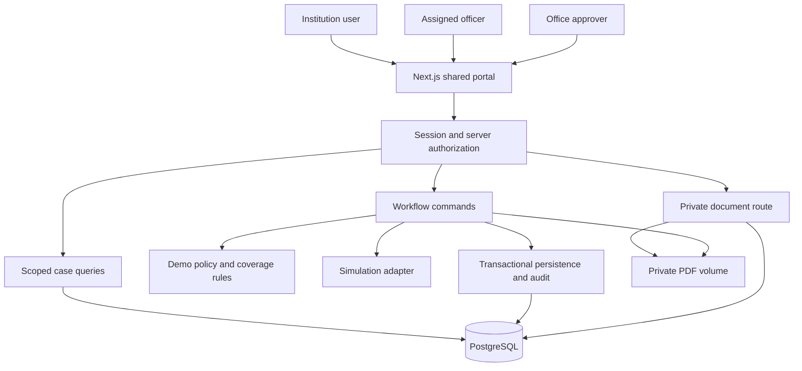

# Prototype Architecture

## 1. Status and boundaries

Target design for the four-day prototype, dated 29 October 2026. The Phase 0 application shell, local PostgreSQL configuration, policy/date helpers and bootstrap checks now exist. Business schema, migrations, authentication and workflows remain unimplemented. Requirements are defined in [PRD.md](/Users/abishekpriyanm/projects/fdr/PRD.md); execution and verification are tracked in [IMPLEMENTATION_PLAN.md](/Users/abishekpriyanm/projects/fdr/IMPLEMENTATION_PLAN.md).

Build a modular monolith: one Next.js application, PostgreSQL and a private file volume. Keep presentation, workflow rules, authorization and storage separated in code without deploying separate services. Use TypeScript, Prisma and Better Auth. Use one existing component library if helpful; do not build a design-system package.

Bank responses are deterministic simulation fixtures. OCR, Python services, workers, message brokers, email delivery, real bank connections and payment execution are outside this architecture's implemented target.

## 2. System view



The browser cannot query the database or file volume directly. Every route/action obtains the authenticated identity server-side and checks the relevant resource scope. Auth library session tables and portal business tables share PostgreSQL, but financial authorization remains an application responsibility.

## 3. Runtime and dependencies

| Layer | Choice | Purpose |
| --- | --- | --- |
| Application | Next.js App Router, TypeScript, Node runtime | Server-rendered queries, forms, server operations and private file routes in one app |
| UI | React, CSS/Tailwind and a familiar accessible component set | Shared shell, forms, dialogs, tables and timeline |
| Authentication | Better Auth email/password sessions | Seeded logins; no custom password/session implementation |
| Persistence | PostgreSQL with Prisma migrations/client | Relations, exact monetary values, transactions and revision checks |
| Files | Private local persistent volume | Synthetic PDF originals and versioned evidence |
| PDF validation | `pdf-lib`, isolated behind the document service | Validate parseability and reject encrypted PDFs; no extraction or document execution |
| Verification | In-process deterministic fixture adapter | Match, mismatch and unavailable outcomes with simulation provenance |
| Validation | Shared server schemas, such as Zod | Validate commands and preserve field-level errors |
| Checks | Workflow integration tests against PostgreSQL; browser automation | Exercise persistence, authorization, concurrency and end-to-end behavior |

Resolve compatible stable package versions during Phase 0 and commit the lockfile. Do not infer version compatibility from this document. Keep PDF encryption rejection enabled; do not bypass it with `ignoreEncryption`. Confirm parser rejection behavior with fixtures before using it; it is not a malware scanner.

For local development, containerize PostgreSQL and persist its data; the app can run on the host. Set a single documented startup sequence. Avoid an ephemeral/serverless filesystem for the private file adapter.

## 4. Module boundaries

| Module | Public responsibility | Important restrictions |
| --- | --- | --- |
| `auth` | Resolve session and portal profile; enforce login | Never trusts submitted role/institution IDs |
| `access` | Scope case/document queries; assert role, office and assignment | Central checks reused by reads, downloads and commands |
| `cases` | Read case workspace and handle submission/review decisions | Owns case revision; mutations go through command transaction wrapper |
| `verification` | Compare submission snapshot with fixture source; persist provenance | Returns `simulation: true`; cannot accept an instrument |
| `coverage` | Calculate and change effective allocations | Never sums instrument rows as coverage |
| `releases` | Scrutiny, authorization, execution evidence and closure | Cannot make payments; cannot close without evidence and officer confirmation |
| `documents` | Validate, store and retrieve private PDF versions | No public paths or arbitrary client-supplied storage keys |
| `audit` | Append transactional case events and query scoped timeline | No application update/delete commands |
| `dashboard` | Derive counts, due actions, ownership and next actions | Uses the same coverage/date functions as case detail |
| `policy` | Expose immutable `DEMO-FDR-1` constants and acceptance rules | No policy-editing interface or claim of regulatory authority |

Keep workflow services independent of React components and request objects. Their input is a validated command and trusted actor context; their output is a typed result or domain error. This allows integration testing without mounting a page.

### Proposed source layout

```text
src/
  app/
    login/page.tsx
    cases/page.tsx
    cases/[caseId]/page.tsx
    cases/[caseId]/submit/page.tsx
    api/auth/[...all]/route.ts
    api/documents/[documentId]/route.ts
  components/                 # Shell, tables, form fields, dialogs, timeline
  server/
    auth/                    # Library configuration and trusted actor context
    access/                  # Scoped queries and permission checks
    db/                      # Prisma client and command transaction wrapper
    cases/                   # Submission, clarification and acceptance
    verification/            # Deterministic simulation adapter
    coverage/                # Interval calculation and assertions
    releases/                # Release workflow
    documents/               # PDF validation and private storage adapter
    audit/                   # Append/query events
    dashboard/               # Counts, filters and derived actions
    policy/                  # Demo policy and date handling
  shared/                    # Validation schemas and safe view models
prisma/                      # Schema, migrations and seed entry point
fixtures/                    # Synthetic PDFs and verification fixtures
tests/                       # Integration and browser journeys
```

This is the target layout; Phase 0 creates only the app shell, database probe, policy helpers and shared contracts. Server-only modules must not leak database clients, secrets or storage paths into browser bundles.

## 5. Domain and storage model

Use generated opaque IDs and timestamps. Explicitly include institution/requirement relationships so a resource ID cannot bypass scope checks. Auth library tables are managed according to the library's integration.

| Business entity | Key fields and relationships |
| --- | --- |
| `Institution` | `id`, `name`, controlled reference |
| `UserProfile` | Auth user ID, role enum, nullable institution ID, nullable office key; institution users have an institution, staff have an office |
| `DepositRequirement` | Institution ID, office key, assigned officer ID, demo policy version, required amount `numeric(18,2)`, currency, required-from/through dates, `OPEN/CLOSED`, case revision, evidence revision |
| `Instrument` | Requirement ID, optional predecessor instrument ID, administrative state, current submission ID; accepted history remains preserved after replacement |
| `SubmissionVersion` | Instrument ID, version number, declared bank/reference/depositor/amount/currency/issue/maturity fields, document ID, submitted actor/time; immutable |
| `DocumentVersion` | Requirement ID, generated storage key, SHA-256, original display name, bytes, MIME, uploader/time; immutable and referenced by a submission or release evidence |
| `VerificationAttempt` | Submission ID, outcome, `simulation=true`, fixture/source key, compared fields, response evidence JSON, actor/time; immutable |
| `InstrumentRecommendation` | Instrument/submission ID, evidence revision, verification attempt ID, policy version, officer, reason/time, invalidation metadata; preserve old recommendations |
| `CoverageAllocation` | Requirement/instrument IDs, allocated amount/currency, `effectiveFrom`, `effectiveToExclusive`, accepting decision reference |
| `ReleaseRequest` | Requirement/instrument IDs, request details, state, requested actor/time, reviewed/approved evidence revision, reviewer/approver and reasons, execution document ID and confirming officer/time |
| `AuditEvent` | Requirement ID, case revision, actor, action, timestamp, reason, before/after summary, evidence IDs, command ID/hash and result references |

Release request changes and old recommendations/decisions remain reconstructible through audit snapshots even when the request row advances its current state. Never put raw PDF bytes, passwords or session tokens in JSON audit data.

### Database constraints and indexes

- Positive monetary values and INR-only check for prototype business records.
- Foreign keys for all parent/version/document/decision links; services additionally assert linked records belong to the same requirement.
- Unique submission version number per instrument and one recommendation/decision effect per command ID.
- Unique audit command ID; store a normalized command hash so a key cannot be reused for different input.
- Index cases by institution, assigned officer/office and state; instruments by requirement/predecessor; allocations by requirement/effective dates; events by requirement/revision; auth tables per library guidance.
- No two allocations may overlap for one requirement. Under this prototype's single-writer case-revision protocol, assert interval non-overlap inside the transaction that creates or closes allocations. Direct database writes outside these services are unsupported; a production design should add stronger database-level constraints.
- Reject deletes of referenced history in application commands. A local demo reset is a separate explicit operation against a clearly identified test database.

## 6. Independent state dimensions

### Instrument administration

`SUBMITTED -> RECOMMENDED -> ACCEPTED`

`SUBMITTED/RECOMMENDED -> CLARIFICATION_REQUIRED -> SUBMITTED` through a new submission version. An approver returning a recommendation chooses clarification when applicant changes are required. `SUBMITTED/CLARIFICATION_REQUIRED` may be withdrawn by its institution; `RECOMMENDED` must first be returned by staff. Approver rejection produces `REJECTED`. Rejected and withdrawn candidates are terminal.

An accepted instrument is immutable in its declared fields. Replacement uses a new instrument. Its historical acceptance survives renewal; `superseded` is a derived display state when a successor has been accepted. Current coverage is determined by allocations, not the administrative enum.

### Source evidence

`NOT_RUN`, `SIMULATED_MATCH`, `SIMULATED_MISMATCH`, `SIMULATED_UNAVAILABLE`.

These describe the latest attempt for the current submission. Older attempts remain in history. There is no `BANK_CONFIRMED` state in this build. Re-running verification can change the current evidence assessment and invalidate dependent recommendations/approvals without erasing the historical acceptance decision.

### Maturity and coverage

Compute `NOT_YET_ISSUED`, `WITHIN_RECORDED_DATES`, `APPROACHING_MATURITY` and `MATURED` from date-only values and the application date in Asia/Kolkata. Compute coverage independently as `COVERED`, `GAP`, `NOT_REQUIRED_ON_DATE` or `CLOSED`; the not-required state covers dates before or after the seeded requirement period.

### Release request

`REQUESTED -> RECOMMENDED -> APPROVED_AWAITING_EXECUTION -> COMPLETED`.

The UI label for `APPROVED_AWAITING_EXECUTION` is `Approved - awaiting execution evidence`; reuse that wording in case detail, queues and the release panel.

Officer clarification uses `CLARIFICATION_REQUIRED`; institution's response returns it to `REQUESTED`. Approver return moves it to `REQUESTED` for fresh scrutiny. A material evidence change in any nonterminal state clears current recommendation/approval metadata and returns it to `REQUESTED`, preserving invalidated decisions in the audit trail. Approver rejection produces `REJECTED`; institution withdrawal before approval produces `WITHDRAWN`. Terminal requests cannot resume; a new eligible request preserves the previous one.

Attaching execution evidence does not complete release. `COMPLETED` requires the separate officer confirmation command and current valid approval. Only then does the requirement become `CLOSED`.

## 7. Coverage and date invariants

All allocation intervals use `[effectiveFrom, effectiveToExclusive)`. Instrument validity includes its maturity date, so its maximum exclusive end is the following calendar date. Use timezone-aware calendar-date helpers rather than adding 24 hours to an arbitrary timestamp.

- Initial acceptance: require a current-version simulated match, sufficient principal, issued/not-matured dates and a valid recommendation. Allocate the requirement amount starting today.
- Renewal acceptance: require the same checks and the latest accepted predecessor. Set successor start to today. Shorten an unexpired predecessor allocation to today; if it ended earlier, leave the end unchanged. Create the successor allocation atomically.
- Same-day replacement can leave a zero-length predecessor interval; retain that acceptance in history, exclude the empty interval from totals and never create an inverted interval.
- Current recorded coverage is the sum of valid, nonempty allocations for open requirements at the as-of date, with at most one allocation per requirement. It excludes expired predecessors and pending/rejected successors.
- Show a gap only while security is required and no valid allocation exists. A pending successor does not fill it.
- Completed full discharge shortens still-active allocation coverage to the completion date and closes the requirement. Do not lengthen an allocation that already ended through maturity.
- The demo permits a full discharge of a matured historical instrument, but approval still needs its current-version simulated match and review. Maturity never supplies the missing authorization or evidence.
- Refuse simultaneous open release and renewal work under the same case transaction.

Historical views describe recorded administrative allocations, not actual bank funds or a bitemporal reconstruction of past knowledge.

## 8. Commands, concurrency and decision freshness

Use Server Actions for form mutations and Route Handlers for auth and document retrieval. This is not a general-purpose CRUD API; avoid a generic endpoint that accepts arbitrary status changes.

| Command group | Operations |
| --- | --- |
| Submission | Submit initial instrument, respond to clarification, withdraw eligible candidate |
| Review | Request clarification, run simulation, recommend acceptance, accept, reject |
| Renewal | Submit successor; reuse submission/review commands |
| Release | Request, clarify/respond, recommend, approve, reject/withdraw, upload execution evidence, confirm completion |

Each mutation accepts the target case ID, expected case revision, generated command ID and validated business fields. Target actor, role and scope come from the session/profile, never the client. Money arrives as a decimal string. Evidence IDs are checked against their parent case.

### Transaction pattern

1. Resolve session/profile; validate the command shape and input hash.
2. In a database transaction, load the scoped requirement and check the role/assignment.
3. If this authorized actor's identical command already succeeded, return its prior safe result. Reuse of the command ID with a different actor, action or input fails.
4. Atomically update the requirement only where its revision equals the submitted expected revision, incrementing the revision. If no row changes, return a conflict; rollback on later failure.
5. Load the authoritative related state under that acquired case write lock; enforce allowed transition, references, evidence freshness and single-active-work rules.
6. Apply all state/interval/decision changes and append the audit event in the same transaction. Commit only if every invariant holds.

All mutations on related business records must follow this protocol. A failed command cannot leave a revision bump or an audit success event behind. Never automatically retry an approval against newly changed evidence; show `This case changed. Review the latest evidence before continuing.`

### Two revision tokens

`caseRevision` increments for every persisted command, including comments and execution attachments. It prevents stale concurrent writes.

`evidenceRevision` increments for material changes: new/corrected FDR submission, a new verification attempt, accepted successor/coverage facts or changes to release conditions. Requirement/policy editing is not exposed. Recommendations and approvals bind to this evidence revision plus the specific submission and verification IDs.

Audit-only views and reading a document change neither token. An execution attachment advances the case revision but does not invalidate the financial authorization it is intended to complete. Its document ID becomes part of the completion evidence. A verification re-run or other material change invalidates dependent live recommendations/approvals; historical decisions remain recorded. A rejected/unavailable later simulation flags risk without rewriting prior acceptance as though it never occurred.

## 9. File handling and failure behavior

Authorize the case before consuming an upload. Enforce the 10 MiB limit at request handling, validate extension/signature and parseability, reject encrypted PDFs, and use generated storage names. Original filenames are display metadata only. Documents are synthetic; upload validation is not malware scanning.

Because a file volume and PostgreSQL do not share a transaction:

1. Validate the file and write it to a private staging path.
2. Move it atomically to a generated final key on the same persistent volume before referencing it in a DB commit.
3. Persist its metadata and business link through the normal case transaction.
4. If the database command fails, remove the unreferenced file. A crash can leave an orphan; a local maintenance command removes only aged files proven unreferenced by the database. Missing referenced files must produce an explicit error, not silent evidence loss.

For downloads, resolve the document's requirement, enforce current access, and stream from the private volume with explicit PDF MIME, no public caching, a safe filename and content-sniffing disabled. An inline preview can use a sandboxed frame; provide an authenticated download fallback. Do not log secrets, raw PDFs or internal absolute paths in user-facing errors.

## 10. Derived work queues

Use one pure mapping from case state to owner/action so the dashboard and detail page agree:

| Situation | Owner | Next action |
| --- | --- | --- |
| Requirement has no submitted instrument | Institution | Submit FDR |
| Submission/renewal awaiting scrutiny | Assigned officer | Review evidence and run simulation |
| Simulated mismatch/unavailable | Assigned officer | Resolve discrepancy/source issue; request clarification where applicable |
| Clarification required | Institution | Respond with corrected submission or requested details |
| Instrument/release recommended | Office approver | Review recommendation and decide |
| Accepted instrument approaching maturity / expired without successor | Institution | Submit renewal; show overdue/gap when applicable |
| Release requested | Assigned officer | Scrutinize release conditions |
| Release approved with no execution attachment | Institution | Provide execution evidence |
| Release approved with execution attachment | Assigned officer | Confirm execution evidence |
| Accepted case with no due work | Assigned officer | Monitor maturity |
| Closed requirement | None | No pending action |

Open release or renewal work takes precedence over normal monitoring, while independent maturity and source-risk flags remain visible. No reminder engine or notification-delivery state is implied by these derived rows.

## 11. Presentation and operating controls

Use the visual requirements in the PRD and the supplied Mobbin reference. The distinctive view is PDF evidence beside financial facts, followed by linked renewal history and decisions. Reuse components across roles; permission checks remain server-side regardless of button visibility.

Configuration includes database URL, auth secret/base URL, private storage path and explicit local-demo mode. Keep secrets outside source control. Disable public signup at the server with the library's `emailAndPassword.disableSignUp` option. Seed through an isolated local bootstrap instance using library-supported account creation; it may allow creation only within that command and must never expose an HTTP signup route. Reset/seed must refuse to run unless the target is explicitly identified as the local demo/test database. Do not reset on ordinary application startup.

Prepare a known-good seed and a recording. A public deployment would need a new review of HTTPS/session settings, private durable object storage, upload isolation/scanning, rate limits, privileged authentication, backups and restore testing. Those are follow-on requirements, not controls already established here.

## 12. Verification strategy

Integration tests use real PostgreSQL transactions, isolated test records and a temporary private file directory. Exercise concurrent commands with independent database connections. Fake only the bank source, since simulation is the product behavior for this release.

Cover role/institution/assignment authorization on queries and commands; direct PDF retrieval; current-version evidence binding; insufficient/mismatched acceptance; interval boundaries and uncovered dates; separate reviewer/approver; release completion gates; command replay; concurrent renewal/release; stale decisions; rollback preserving audit consistency; persistence through restart.

Browser tests will log in through the real seeded auth flow and run submission, clarification, acceptance, renewal and release. Capture the verification banner, coverage total and awaiting-execution state. Manually inspect keyboard focus, the 390px layout, long values and PDF fallback. Phase 0 verification covers only the bootstrap shell and policy/date foundation; later workflow checks are still pending.

## 13. Decisions and later extension points

| Decision | Reason / limitation |
| --- | --- |
| One app instead of React plus FastAPI | Smaller setup/integration surface for four days; Python can be added later behind a document-processing interface if justified |
| PostgreSQL rather than browser state or an in-memory store | Transactional case history and concurrency behavior are central to the demonstration |
| Private local files rather than cloud integration | Reliable offline demo; not compatible with ephemeral deployment storage |
| Immutable submission snapshots | Decision evidence can be reconstructed after corrections |
| Explicit case-revision transaction protocol | Small, testable write path for renewal/release conflicts; bypass writes remain unsupported |
| Immutable demo policy | No invented universal regulatory rules and no policy-editor scope |
| Read-time maturity derivation | Demonstrates due work without a worker, scheduler or notification promises |

Potential later extensions include an authorized bank adapter, document extraction worker, durable notification outbox, versioned policy publication and database-enforced coverage exclusion constraints. Each requires a separate scope decision; none is on the four-day critical path.

## 14. Technical references

- [Next.js authentication and server authorization](https://nextjs.org/docs/app/guides/authentication): check authorization at every server entry point.
- [Better Auth installation and integration](https://better-auth.com/docs/installation): library-managed authentication/session setup.
- [Better Auth options](https://better-auth.com/docs/reference/options): server-side email/password signup restriction.
- [PDF-LIB encryption handling source](https://github.com/Hopding/pdf-lib/blob/master/src/api/PDFDocument.ts): encrypted input rejection; keep the default check enabled.
- [Prisma transaction and concurrency guidance](https://docs.prisma.io/docs/orm/v7/prisma-client/queries/transactions): transaction boundaries and optimistic concurrency patterns; adapt examples to the version actually installed.
- [PostgreSQL row locking](https://www.postgresql.org/docs/current/explicit-locking.html): database concurrency semantics underlying serialized case writes.
